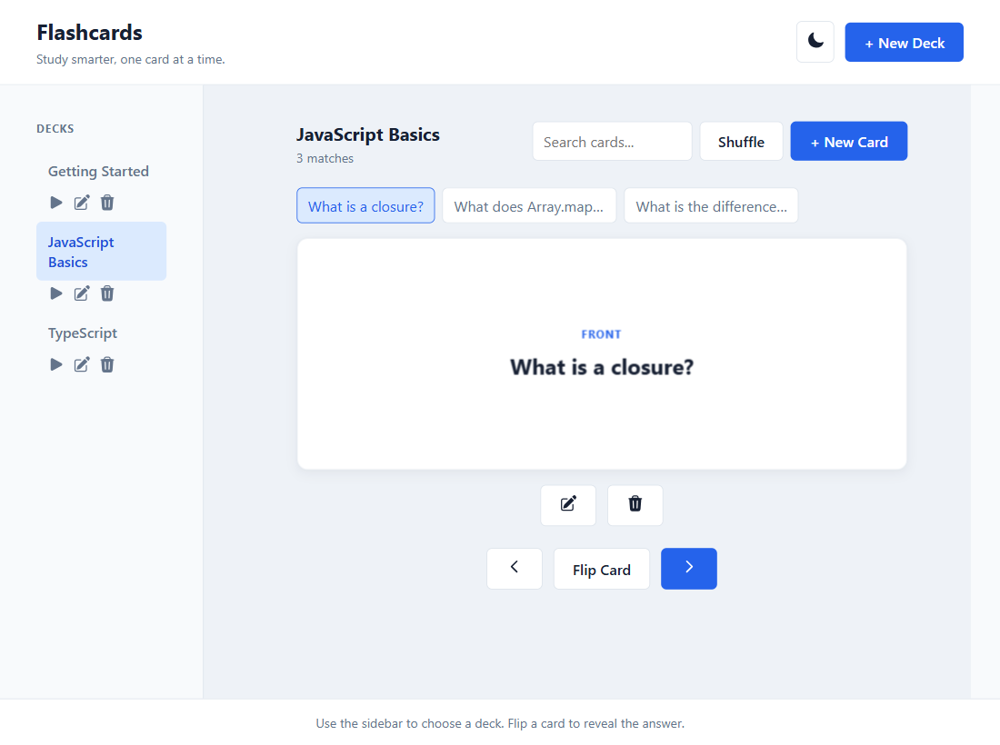
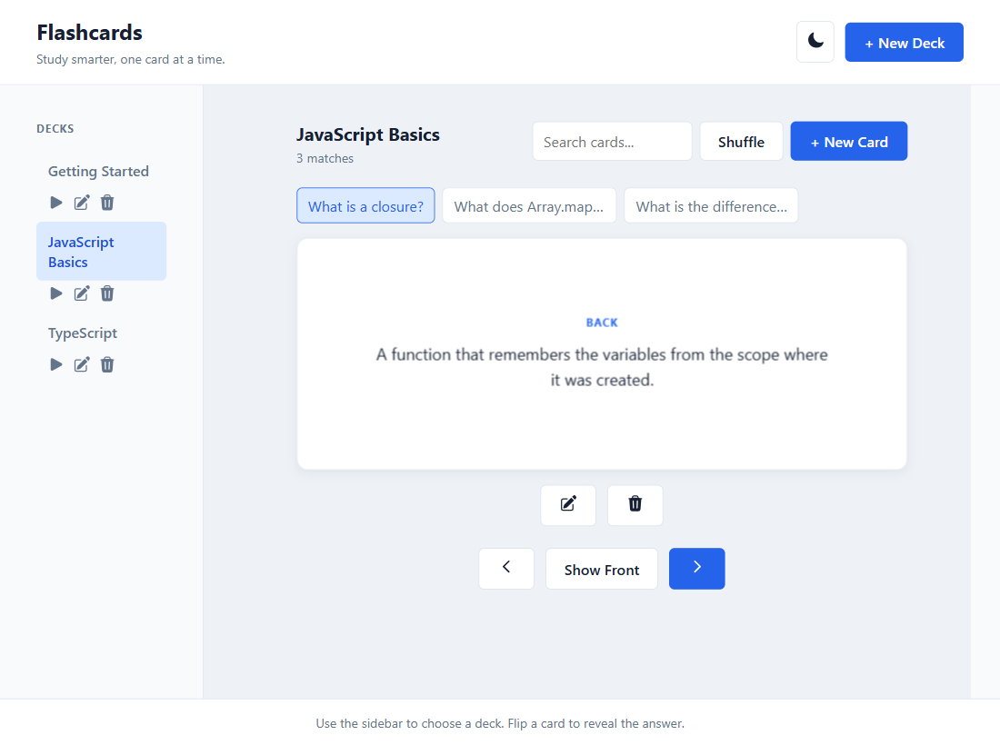
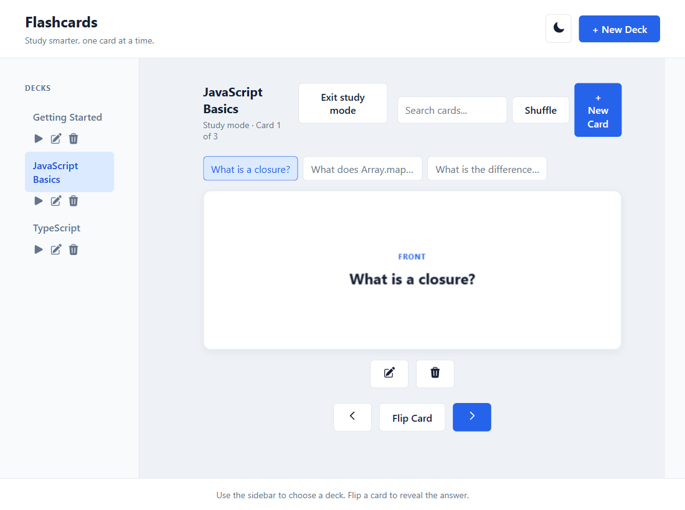
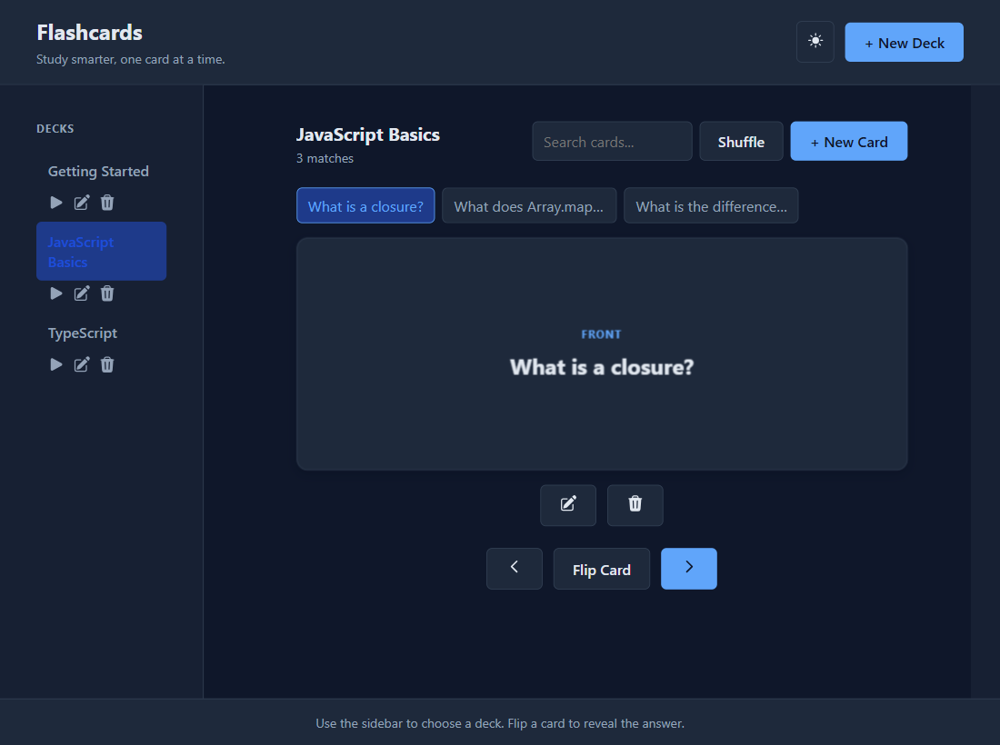
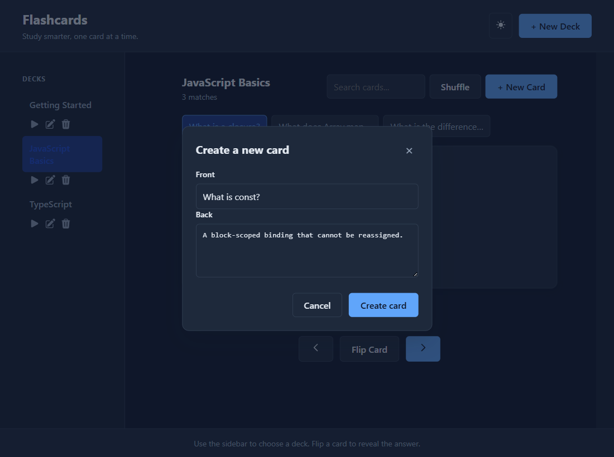

# Flashcards

A browser-based study app for creating decks, flipping cards, and reviewing them one at a time. Decks and cards stay in `localStorage`, so they are still there after a refresh.

## Screenshots

These images use extra sample cards so the deck, flip, and study screens are easier to see. A fresh install starts with one card in **Getting Started**.

**Deck view.** Choose a deck, search the cards, and flip the active card.



**Flipped card.** The back of the card shows the answer.



**Study mode.** The play button on a deck opens a focused review. Arrow keys move between cards, and Space or Enter flips the current card.



**Dark mode.** The header toggle switches between light and dark, and the choice is saved with the rest of the app state.



**New card.** Create or edit a card from a dialog with a front and a back.



## Features

- Create, rename, and delete decks
- Add, edit, delete, search, and shuffle cards
- Flip a card, then move to the previous or next card
- Study mode with keyboard controls
- Light and dark themes
- Empty states for no decks, an empty deck, and a search with no matches
- Icon buttons include `aria-label` text so screen readers can name them

## Getting started

```bash
npm install
npm run dev
```

Open the URL Vite prints, usually `http://localhost:5173/`.

Other scripts:

| Command | What it does |
| --- | --- |
| `npm run build` | Type-check and build for production |
| `npm run preview` | Serve the production build |
| `npm run lint` | Run ESLint |

The app starts with three sample decks. **Getting Started** has one card. **JavaScript Basics** and **TypeScript** are empty until you add cards. Anything you create is saved in the browser under the key `flashcards-app-state`.

## How to study

1. Select a deck in the sidebar, or press the play icon to enter study mode.
2. Press **Flip Card** to reveal the answer. Press it again to show the front.
3. Use the arrow buttons to move through the deck, or **Shuffle** to reorder it.
4. In study mode, press **Escape** to leave.

| Key | In study mode |
| --- | --- |
| `Space` or `Enter` | Flip the card |
| `ArrowRight` | Next card |
| `ArrowLeft` | Previous card |
| `Escape` | Exit study mode |

## Tech stack

- React 19 and TypeScript
- Vite
- CSS with a light and dark theme (no component library)

## Reflection

- **Where AI saved time:** AI significantly accelerated the initial setup by rapidly generating the boilerplate for state management (using `useState` and `useEffect`), the semantic HTML structure of the application shell, and the CSS grid layout, saving hours of manual setup.
- **AI bug identified and fixed:** The AI generated the UI for the "Previous", "Next", and "Shuffle" buttons but failed to wire them up to any `onClick` event handlers. I fixed this by implementing `handleNextCard`, `handlePrevCard`, and `handleShuffle` state transition logic and binding them directly to the buttons to restore full functionality.
- **Code refactored for clarity:** I refactored the standard text buttons (`Study`, `Rename`, `Delete`, `Edit card`, `Previous`, `Next`) in the UI into sleek, accessible SVG icons. This cleared up visual clutter in the interface and made the application look much cleaner and more modern.
- **Accessibility improvement added:** When I replaced the text buttons with SVG icons, I explicitly added `aria-label` attributes (e.g., `aria-label="Edit card"`) to ensure the controls remain fully accessible to screen readers despite having no visible text.
- **Prompt changes that improved AI output:** Providing highly specific instructions (like providing the exact SVG code and line numbers to replace) rather than vague requests (like "make the buttons look better") yielded much more accurate, predictable, and usable code modifications without unintended side effects.
